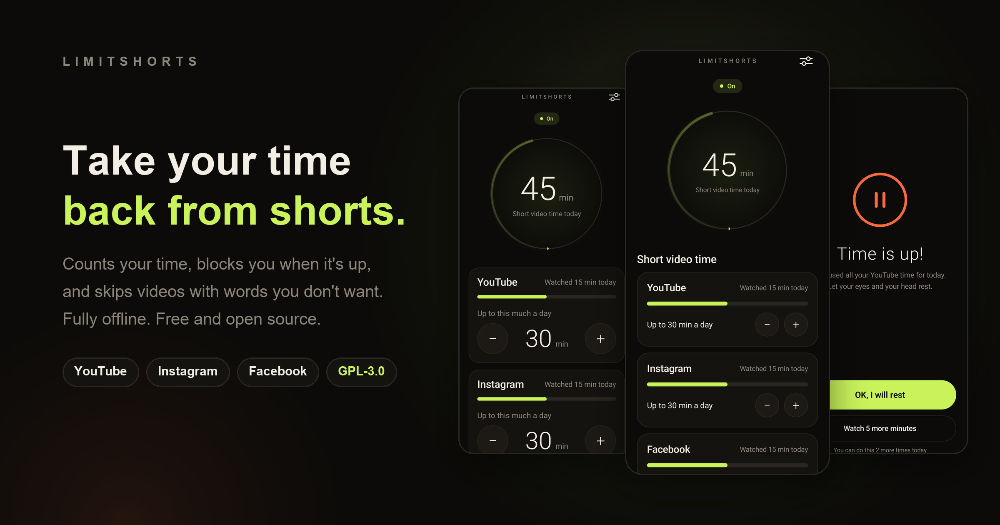
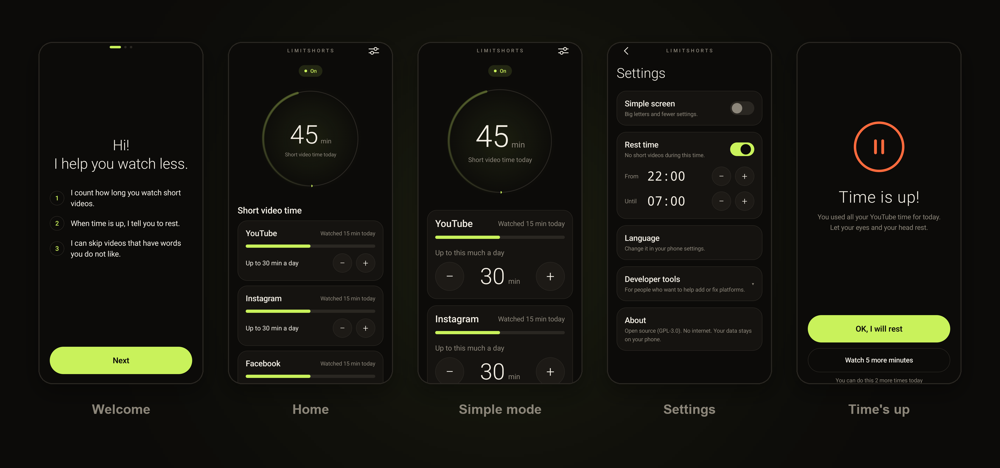
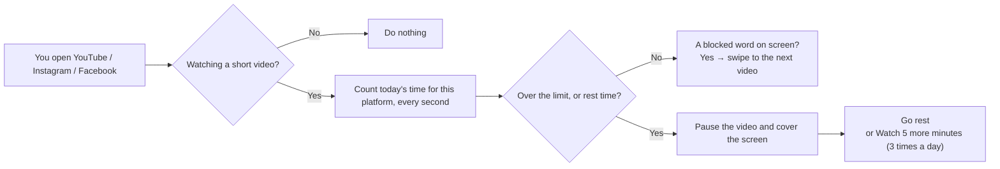

<div align="center">



<br>

[](LICENSE)
[](#install)
[](#privacy--permissions)
[](#)

**[Install](#install) &nbsp;·&nbsp; [How to use](#how-to-use) &nbsp;·&nbsp; [Platforms](#supported-platforms) &nbsp;·&nbsp; [Privacy](#privacy--permissions) &nbsp;·&nbsp; [Contribute](#develop--contribute)**

**English** &nbsp;·&nbsp; [繁體中文](README.zh-TW.md)

</div>

<br>

## What is LimitShorts

An Android app built for one thing: **YouTube Shorts, Instagram Reels and Facebook Reels**.

It does not lock the whole app. It steps in only while you are **actually scrolling short videos**. Long videos and your friends' posts are left alone.

<table>
<tr>
<td width="33%" valign="top">

### ⏱ Count the time

Every platform has its own daily limit. Count **short videos only** (the default) or **all the time the app is open**.

</td>
<td width="33%" valign="top">

### ✋ Block when it's up

The whole screen is covered and the video is paused. You can ask for more time, **3 times a day at most**.

</td>
<td width="33%" valign="top">

### ⏭ Skip words you hate

Add a few words, like `AI`. When a video shows one, it swipes to the next.

</td>
</tr>
</table>

There is also **Rest time** (for example, no shorts from 10 pm to 7 am), a **Simple screen** for older family members, and three interface languages: English, 繁體中文 and 日本語.

<br>

## Screens



The simple screen uses bigger letters and bigger buttons, and keeps only two things: how long you can watch, and rest at night.

<br>

## How it works



"Watching a short video?" is answered with Android's **accessibility service**, which reads the structure of the screen (which elements exist, which tab is selected). LimitShorts **does not record, take screenshots, or read your messages**. See [Privacy](#privacy--permissions).

<br>

## Install

> There is no prebuilt APK yet. For now you build it yourself, which takes about 5 minutes.

### You need

| Item | Version |
|---|---|
| Phone | Android 8.0 (API 26) or newer |
| Computer | JDK **21** and the Android SDK (platform 35). Android Studio brings both |

> Heads up: the JDK bundled with Android Studio can be newer than 21, and Gradle 8.10 fails on it. Point `JAVA_HOME` to JDK 21.

### Build

```bash
git clone https://github.com/ReoNaBear/LimitShorts.git LimitShorts
cd LimitShorts

# Windows
gradlew.bat assembleDebug
# macOS / Linux
./gradlew assembleDebug
```

The file is at `app/build/outputs/apk/debug/app-debug.apk`.

### Put it on your phone

Connect the phone, turn on USB debugging, then:

```bash
adb install -r app/build/outputs/apk/debug/app-debug.apk
```

You can also copy the APK to the phone and open it from a file manager (allow "install unknown apps" first).

### Turn on the accessibility service (required)

LimitShorts needs it to know whether you are watching a short video. The first-run guide in the app walks you through it. Or do it yourself:

1. Open the app and tap **Turn it on**
2. Find **LimitShorts** in the list
3. Switch it on and come back. The home screen shows **On**

> **If the switch is greyed out**, or you see "Restricted setting": Android 13+ protects against apps installed from outside the store. Go to
> **Settings → Apps → LimitShorts → ⋮ (top right) → Allow restricted settings**, then try again.

<br>

## How to use

| You want to… | Do this |
|---|---|
| Choose what counts | The switch on each platform card on the home screen: **Short videos only** or **Whole app**. Each platform has its own choice |
| Set the daily limit | Tap **−** or **+** on a platform card on the home screen. Steps of 5 minutes, from 5 to 180 |
| Get a little more time when it's up | Tap **Watch 5 more minutes** on the "Time is up" screen. 3 times a day per platform |
| Add a word you don't want to see | "Words I do not want to see" at the bottom of the home screen. Type one word and tap **Add**. Tap a word to remove it |
| Block shorts at night | **Settings → Rest time**. Switch it on and set start and end (30-minute steps). Rest time **cannot be extended** |
| Use the big-letter screen | **Settings → Simple screen**. You can also pick it during the first run |
| Change the language | **Settings → Language** (Android 13+, opens the system per-app language page) |
| See this week | The "This week" chart on the home screen. The bright green bar is today |

**How blacklist words match:** plain English or number words (like `AI`) must match as a **whole word**, so `MAIN` does not trigger. Chinese, Japanese and other scripts match anywhere in the text.

**When does it reset:** after midnight (phone time), usage, extensions and skip counts go back to zero. Your limits and words stay.

<br>

## Supported platforms

| Platform | How it knows you're in shorts | Can it read titles and hashtags? | Verified with |
|---|---|---|---|
| **YouTube** | Elements that only exist on the Shorts player (`reel_*`) | ✅ Yes | 21.40 (Android 17 emulator), 21.39 (Sharp SH-M35, Android 16) |
| **Instagram** | Elements that only exist on the Reels player (`clips_viewer_*`) | ⚠️ **No.** The caption is collapsed to "See more", so only the author name is readable | 451.0 (Android 17 emulator), 450.0 (Sharp SH-M35, Android 16, Traditional Chinese UI) |
| **Facebook** | The "Reels" tab is selected | ✅ Yes | 582.0, English UI (Android 17 emulator); 582.0.0.50.54, **Traditional Chinese UI** (Sharp SH-M35, Android 16) |

An app update can break detection. That is why the rules live in separate JSON files: you can fix a rule without touching code. See [Develop & contribute](#develop--contribute).

<br>

## Privacy & permissions

**LimitShorts is fully offline.** `AndroidManifest.xml` has no `INTERNET` permission, and an [automated test](#tests) checks it on every run.

| Topic | What really happens |
|---|---|
| The only permission it needs | Accessibility service |
| Which apps it can see | **Only** YouTube, Instagram and Facebook. Every other app is invisible to it (fixed in [`accessibility_service_config.xml`](app/src/main/res/xml/accessibility_service_config.xml)) |
| What it reads | The structure of the screen (which elements exist, which tab is selected) and the visible text, used only to match your blacklist |
| What it stores | Seconds used per platform today, your settings, your words. Only on this phone |
| What it never does | Record, take screenshots, upload, read messages, collect any data |
| How it covers the screen | The accessibility service's own overlay window, so you do **not** need to grant "Display over other apps" |
| What else it looks at | The position and size of **system windows** on screen (for example the navigation bar), only so the overlay does **not cover** Back and Home. It does not read their content |

The screen recorder in "Developer tools" is **off by default**. When on, it saves screen structures as files on the phone, readable only through `adb` by you. Please do not post recordings that contain personal data.

<br>

## Develop & contribute

### Layout

```
app/src/main/
├── assets/rules/          ← detection rules per platform (JSON). The easiest place to contribute
├── java/org/limitshorts/app/
│   ├── data/              ← Store (usage & settings), Rules, QuietHours, BlockPolicy
│   ├── service/           ← LimitService (core), BlockOverlay, keyword matching
│   └── ui/                ← Jetpack Compose screens
└── res/values*/           ← English, 繁體中文 (zh-TW), 日本語 strings
```

Stack: Kotlin, Jetpack Compose, no third-party libraries, no Google Play services (so F-Droid is possible later).

### Add or fix a platform

A rule file ([`youtube.json`](app/src/main/assets/rules/youtube.json)):

```jsonc
{
  "id": "youtube",
  "name": "YouTube",
  "package": "com.google.android.youtube",
  "shortsViewIds": ["reel_recycler", "reel_player_page_container"], // element IDs that only exist in shorts
  "selectedTabPrefixes": [],      // selected tab whose description starts with these (for apps without IDs, e.g. Facebook)
  "ignoreTopFraction": 0.0,       // ignore this top share of the screen when reading keywords (tab bar, title bar)
  "ignoreBottomFraction": 0.12    // ignore this bottom share (bottom navigation)
}
```

How to find the rule:

1. Install the app on a phone or emulator and log in
2. Open LimitShorts: **Settings → Developer tools**, switch on "Save screen structure"<br>
   (**it is hidden while Simple screen is on**, so switch that off first)
3. Watch a few short videos in the target app, and look at its home feed too
4. Pull the files: `adb pull /sdcard/Android/data/org.limitshorts.app/files/dumps`
5. Compare a shorts-page file with a home-page file. Find an element ID or tab name that exists **only on the shorts page**, and write it into the JSON
6. Add the package name to `packageNames` in `app/src/main/res/xml/accessibility_service_config.xml`
7. Run the tests to check the rule file

### Tests

```bash
# Logic (JVM, a few seconds): rest time, keywords, block decision, storage, rule files, no internet permission
./gradlew testDebugUnitTest

# Screens (needs an emulator or phone): every screen's buttons and the whole app flow
./gradlew connectedDebugAndroidTest
```

There are 63 unit tests and 37 screen tests.

### Design

Warm black (`#0C0B09`), warm white text, and only two meaningful colors: **lime `#C9F25B` means running**, **orange `#FF6A3D` means look here**. Big thin numerals. Every button is at least 48dp.

<br>

## FAQ

**What is the difference between "Short videos only" and "Whole app"?**

| | Short videos only (default) | Whole app |
|---|---|---|
| When it counts | While you are on a short-video page | While the app is in the foreground, on any page |
| When the limit is reached | Blocks only the short-video pages; the rest of the app works | Blocks the whole app |
| Rest time | Blocks short-video pages only | Blocks the whole app |
| Blocked-word auto skip | Yes | **Still only on short-video pages**, so it never swipes through your normal feed |

Both are per platform, and the limit and extension rules are the same.

**On Facebook I want "count whenever I'm watching a video or Reels, wherever it is". Can I?**

Use **Whole app**: all the time Facebook is in the foreground counts, including videos in the feed and Reels opened from anywhere.

**When time is up, does the video really stop?**

Yes, and not just by covering the screen. Covering the screen is not enough, because the sound keeps playing underneath (in testing, YouTube kept playing in the background even after pressing Home). So LimitShorts does this, in order:

1. Takes **audio focus** and sends a pause key. This makes YouTube pause.
2. After 0.6 s, **if sound is still playing**, it taps the middle of the video once to pause it. Instagram ignores audio focus, so it needs this step. It only taps when something is still playing, so it never turns an already-paused video back on.
3. After another 0.6 s, it shows "Time is up".
4. If the video is still playing after that (for example it autoplays the next one), it pauses again, and if that fails it **goes straight to the home screen**.

Pressing "Go rest" does not make it resume.

| Platform | Verified on a real phone (Sharp SH-M35) |
|---|---|
| YouTube | ✅ Pauses when blocked, and does not resume after "Go rest" |
| Instagram | ✅ Pauses when blocked, and does not resume after "Go rest" |
| Facebook | ✅ Pauses when blocked and does not resume |

<br>

**If I tap into a post or the home feed and keep swiping videos, does it count?**

It looks at **which screen you are on now**, not how you got there. If you end up in the app's **full-screen short-video player**, it counts.

| Platform | Where you tapped in from | Result |
|---|---|---|
| YouTube | Shorts tab, the Shorts shelf on Home | ✅ Counts (tested) |
| Instagram | Reels tab, Reels in Explore | ✅ Counts (tested) |
| Facebook | Reels tab | ✅ Counts (tested) |
| Facebook | A Reel item opened from the news feed | ❌ **Not counted for now** (tested on a real phone: opening an item marked Reel in the feed did not start the timer). To count everything, choose "Whole app" |
| All | A normal post whose video plays inline in the feed (no full-screen player) | ❌ Does not count |

<br>

## Known limits

- **Instagram titles and hashtags are not readable.** The blacklist only matches the author name there.
- **Facebook detection relies on tab text.** Verified on the English UI (emulator) and the Traditional Chinese UI (real phone). Other languages may need extra rules, and Reels opened from the news feed are not supported yet.
- **Only in-app Reels / Shorts pages count.** Short videos watched elsewhere (for example in a browser) are not counted. With "Whole app" only the time the app is in the foreground counts, so a browser is not included either.
- **App updates can break detection** and need a rule update.
- Only English, 繁體中文 and 日本語 for now.
- Real-device testing was done on one phone, a **Sharp SH-M35 (Android 16)**, with YouTube, Instagram and Facebook installed. Other brands and Android versions are not tested yet.

<br>

## License

[GPL-3.0](LICENSE). Use it, change it, share it freely. Modified versions must be released under the same terms.
