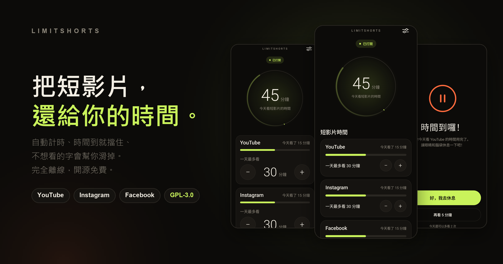
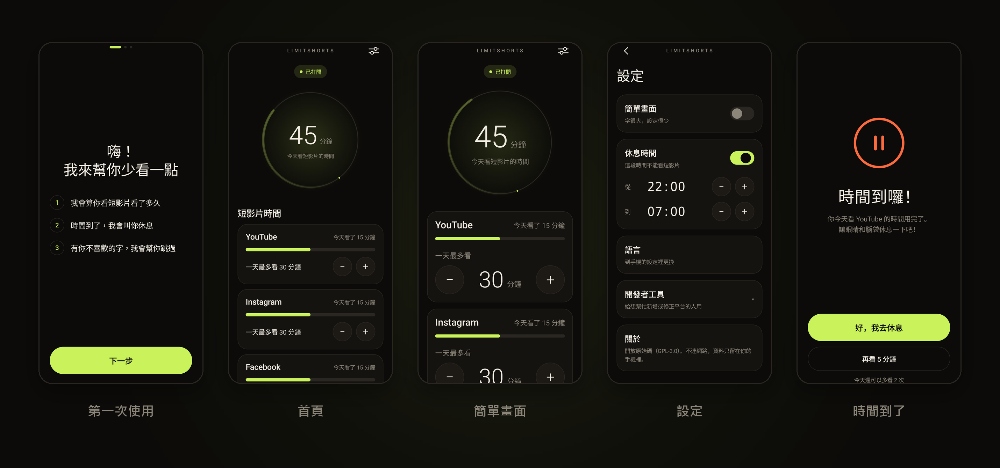
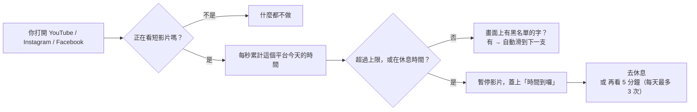

<div align="center">



<br>

[](LICENSE)
[](#安裝)
[](#隱私與權限)
[](#)

**[安裝](#安裝) &nbsp;·&nbsp; [使用方式](#使用方式) &nbsp;·&nbsp; [支援的平台](#支援的平台) &nbsp;·&nbsp; [隱私與權限](#隱私與權限) &nbsp;·&nbsp; [開發與貢獻](#開發與貢獻)**

[English](README.md) &nbsp;·&nbsp; **繁體中文**

</div>

<br>

## LimitShorts 是什麼

一個 Android App，專門管 **YouTube Shorts、Instagram Reels、Facebook Reels**。

它不是把整個 App 鎖起來，而是只在你**真的在刷短影片**的時候出手。你可以正常看長影片、看朋友的貼文，不會被打擾。

<table>
<tr>
<td width="33%" valign="top">

### ⏱ 算時間

每個平台各算各的。你可以選**只算短影片**（預設），或**整個 App 打開的時間都算**。

</td>
<td width="33%" valign="top">

### ✋ 時間到就擋

時間用完，整個畫面蓋上「時間到囉」，影片同時暫停。可以延長，但**每天最多 3 次**。

</td>
<td width="33%" valign="top">

### ⏭ 不想看的字，自動滑走

加幾個黑名單的字，例如 `AI`。影片裡出現，就自動滑到下一支。

</td>
</tr>
</table>

另外還有「**休息時間**」（例如晚上 10 點到早上 7 點完全不能看）、給長輩用的「**簡單畫面**」，以及繁體中文、English、日本語三種介面。

<br>

## 畫面



簡單畫面把字放大、按鈕放大，只留「一天最多看多久」和「晚上要休息」兩件事。

<br>

## 它怎麼運作



「正在看短影片嗎」這一步，靠的是 Android 的**無障礙服務**去讀畫面的結構（有哪些元件、哪個分頁被選到）。LimitShorts **不錄影、不截圖、不讀你的訊息**。細節在 [隱私與權限](#隱私與權限)。

<br>

## 安裝

### 下載

到[**最新版本**](https://github.com/ReoNaBear/LimitShorts/releases/latest)下載 APK，傳到手機後用檔案管理員點開安裝（要先允許「安裝未知的應用程式」），再打開無障礙服務（見下面）。需要 Android 8.0（API 26）以上。

想確認檔案沒被改過，可以把它的 SHA-256 和旁邊 `.sha256` 檔案裡的值比對。

### 或是自己建置

大約 5 分鐘。

#### 你需要

| 項目 | 版本 |
|---|---|
| 手機 | Android 8.0（API 26）以上 |
| 電腦 | JDK **21**、Android SDK（含 platform 35）。裝了 Android Studio 就都有 |

> 注意：Android Studio 內建的 JDK 可能比 21 新，會讓 Gradle 8.10 失敗。請把 `JAVA_HOME` 指到 JDK 21。

#### 建置

```bash
git clone https://github.com/ReoNaBear/LimitShorts.git LimitShorts
cd LimitShorts

# Windows
gradlew.bat assembleDebug
# macOS / Linux
./gradlew assembleDebug
```

做好的檔案在 `app/build/outputs/apk/debug/app-debug.apk`。

#### 裝到手機

手機接上電腦，打開「USB 偵錯」，然後：

```bash
adb install -r app/build/outputs/apk/debug/app-debug.apk
```

也可以把 APK 傳到手機，用檔案管理員點開安裝（要先允許「安裝未知的應用程式」）。

### 打開無障礙服務（一定要做）

LimitShorts 要靠這個才看得到你有沒有在刷短影片。App 裡的「第一次使用」會一步一步帶你，也可以自己來：

1. 打開 App，按「**去打開**」
2. 在清單裡找到 **LimitShorts**
3. 把開關打開，回到 App，首頁會顯示「**已打開**」

> **如果開關是灰的**，或出現「受限制的設定」：這是 Android 13 以上對「自己安裝的 App」的保護。到
> **設定 → 應用程式 → LimitShorts → 右上角 ⋮ → 允許受限制的設定**，再回去打開。

<br>

## 使用方式

| 你想做的事 | 怎麼做 |
|---|---|
| 選擇要算哪些時間 | 首頁每個平台卡片上的切換：**只算短影片**，或**整個 App**。每個平台各自選 |
| 設定一天最多看多久 | 首頁的平台卡片，按 **−** 或 **＋**，每次 5 分鐘（5 到 180 分鐘） |
| 時間用完了還想看一下 | 「時間到囉」畫面按「**再看 5 分鐘**」。每個平台每天最多 3 次 |
| 加不想看到的字 | 首頁最下面「不想看到的字」，輸入一個字，按「加入」。要刪掉就點那個字 |
| 晚上不准看 | **設定 → 休息時間**，打開開關，調開始和結束時間（每次動 30 分鐘）。休息時間**不能延長** |
| 換成大字的簡單畫面 | **設定 → 簡單畫面** 打開開關。第一次使用時也可以直接選 |
| 換語言 | **設定 → 語言**（Android 13 以上，會帶你到系統的 App 語言頁） |
| 看這一週用了多久 | 首頁的「這一週」圖表，最右邊的亮綠色是今天 |

**黑名單怎麼比對：** 純英文、數字的字（例如 `AI`）要「整個字」才算，所以 `MAIN` 不會被誤判；中文、日文等就只要有出現就算。

**每天什麼時候歸零：** 手機時間過了午夜，用量、延長次數、跳過次數都會歸零。你設的上限和黑名單不會變。

<br>

## 支援的平台

| 平台 | 怎麼知道在看短影片 | 讀得到標題和 hashtag 嗎 | 驗證過的版本 |
|---|---|---|---|
| **YouTube** | Shorts 播放頁才有的元件（`reel_*`） | ✅ 讀得到 | 21.40（Android 17 模擬器）、21.39（Sharp SH-M35，Android 16） |
| **Instagram** | Reels 播放頁才有的元件（`clips_viewer_*`） | ⚠️ **讀不到**。說明預設收合成「See more」，只讀得到作者名稱 | 451.0（Android 17 模擬器）、450.0（Sharp SH-M35，Android 16，繁中介面） |
| **Facebook** | 「Reels」分頁被選取 | ✅ 讀得到 | 582.0，英文介面（Android 17 模擬器）、582.0.0.50.54，**繁中介面**（Sharp SH-M35，Android 16） |

App 改版就可能讓判斷失效。這就是為什麼判斷規則放在獨立的 JSON 檔，改規則不用動程式，見 [開發與貢獻](#開發與貢獻)。

<br>

## 隱私與權限

**LimitShorts 完全離線。** `AndroidManifest.xml` 裡沒有 `INTERNET` 權限，而且有[自動化測試](#測試)每次都在檢查這件事。

| 項目 | 實際情況 |
|---|---|
| 它要的唯一權限 | 無障礙服務 |
| 它看得到哪些 App | **只有** YouTube、Instagram、Facebook。這三個以外的 App，它完全看不到（寫死在 [`accessibility_service_config.xml`](app/src/main/res/xml/accessibility_service_config.xml)） |
| 它讀什麼 | 畫面的結構（有哪些元件、哪個分頁被選到），以及畫面上看得到的文字（只用來比對你的黑名單） |
| 它存什麼 | 每個平台今天用了幾秒、你的設定、黑名單。只存在這支手機裡 |
| 它不做什麼 | 不錄影、不截圖、不上傳、不看訊息、不收集任何資料 |
| 擋住畫面用什麼 | 無障礙服務自己的覆蓋視窗，所以**不用**另外授權「顯示在其他 App 上層」 |
| 它也會看什麼 | 螢幕上**系統視窗**（例如導覽列）的位置和大小，只為了讓覆蓋畫面**不要蓋住**返回、首頁鍵。不讀這些視窗的內容 |

「開發者工具」的畫面記錄功能**預設關閉**。打開後它會把畫面結構存成檔案放在手機裡，只有你自己用 `adb` 才拿得到。請不要把含有個人資料的記錄貼到公開的地方。

<br>

## 開發與貢獻

### 專案結構

```
app/src/main/
├── assets/rules/          ← 每個平台的判斷規則（JSON）。社群最容易貢獻的地方
├── java/org/limitshorts/app/
│   ├── data/              ← Store（用量與設定）、Rules、QuietHours、BlockPolicy
│   ├── service/           ← LimitService（核心）、BlockOverlay、關鍵字比對
│   └── ui/                ← Jetpack Compose 畫面
└── res/values*/           ← 繁中（zh-TW）、English、日本語 文字
```

技術：Kotlin、Jetpack Compose、沒有第三方函式庫、不依賴 Google Play 服務（方便之後上 F-Droid）。

### 新增或修正一個平台

規則檔長這樣（[`youtube.json`](app/src/main/assets/rules/youtube.json)）：

```jsonc
{
  "id": "youtube",
  "name": "YouTube",
  "package": "com.google.android.youtube",
  "shortsViewIds": ["reel_recycler", "reel_player_page_container"], // 短影片頁才有的元件 ID
  "selectedTabPrefixes": [],      // 被選取的分頁，描述以這些字開頭（沒有元件 ID 的 App 用，例如 Facebook）
  "fullScreenPrefixes": [],       // 選填：佔滿大半個螢幕、描述以這些字開頭的元件（Facebook 從動態點開的全螢幕 Reel）
  "ignoreTopFraction": 0.0,       // 讀關鍵字時，略過畫面最上面這個比例（分頁列、標題列）
  "ignoreBottomFraction": 0.12    // 略過最下面這個比例（底部導覽列）
}
```

找規則的步驟：

1. 把 App 裝在手機或模擬器上，登入
2. 打開 LimitShorts：**設定 → 開發者工具**，打開「記下畫面的樣子」<br>
   （**簡單畫面開啟時看不到**這一項，先到設定把它關掉）
3. 去目標 App 看一下短影片，也看一下首頁
4. 把記錄拉回電腦：`adb pull /sdcard/Android/data/org.limitshorts.app/files/dumps`
5. 比較「短影片頁」和「首頁」的記錄，找出**只有短影片頁才有**的元件 ID 或分頁名稱，寫進 JSON
6. 在 `app/src/main/res/xml/accessibility_service_config.xml` 的 `packageNames` 加上它的套件名稱
7. 跑測試，確認規則格式正確

### 測試

```bash
# 邏輯（JVM，幾秒鐘）：休息時段、關鍵字、阻擋判斷、儲存、規則檔格式、沒有網路權限
./gradlew testDebugUnitTest

# 畫面（要接著模擬器或手機）：每個畫面的按鈕與整個 App 的流程
./gradlew connectedDebugAndroidTest
```

目前有 66 個單元測試和 37 個畫面測試。

### 設計

暖黑底（`#0C0B09`）、米白字，只有兩種有意義的顏色：**萊姆綠 `#C9F25B` 代表運作中**，**橘 `#FF6A3D` 代表需要你注意**。數字用細體放大。所有按鈕至少 48dp。

<br>

## 常見問題

**「只算短影片」和「整個 App」差在哪？**

| | 只算短影片（預設） | 整個 App |
|---|---|---|
| 什麼時候計時 | 在短影片播放頁的時候 | 這個 App 在前景的時候，不管你在哪一頁 |
| 到上限會擋 | 只有進到短影片頁才擋，其他頁照常用 | 整個 App 都擋 |
| 休息時間 | 只擋短影片頁 | 擋整個 App |
| 黑名單自動滑走 | 有 | **一樣只在短影片頁做**，不會在一般動態裡亂滑 |

兩種都是每個平台各算各的，上限、延長次數的規則也一樣。

**Facebook 我想「不管在哪裡，只要在看影片或 Reels 就算」，可以嗎？**

可以用「**整個 App**」：Facebook 在前景的時間全部都算，包含動態裡的影片和任何地方打開的 Reels。

**時間到的時候，影片真的會停嗎？**

會，而且不是只有蓋住畫面。蓋住畫面沒用，因為影片的聲音會繼續在底下播（實測 YouTube 連按 Home 回到桌面都還在背景播）。所以 LimitShorts 會依序做這幾件事：

1. 搶下**音訊焦點**，並送出暫停鍵。這會讓 YouTube 暫停。
2. 0.6 秒後，如果**還有聲音在播**，才在影片中央輕點一下讓它暫停。Instagram 不理音訊焦點，需要這一步。只有確定還在播才點，所以不會把已經暫停的影片點成播放。
3. 再過 0.6 秒，才蓋上「時間到囉」。
4. 蓋上之後如果影片還在播（例如自動播下一支），先再暫停一次，還是不行就**直接回到桌面**。

按「去休息」之後也不會自動恢復播放。

| 平台 | 實機驗證（Sharp SH-M35） |
|---|---|
| YouTube | ✅ 被擋時暫停，按「去休息」後不再恢復 |
| Instagram | ✅ 被擋時暫停，按「去休息」後不再恢復 |
| Facebook | ✅ 被擋時暫停，不再恢復 |

<br>

**從貼文或首頁點進去，再繼續往下滑，算不算？**

看的是「你現在在哪一頁」，不是「你從哪裡進來的」。只要點進去之後是 App 的**全螢幕短影片播放頁**，就會算。

| 平台 | 從哪裡點進去 | 結果 |
|---|---|---|
| YouTube | Shorts 分頁、首頁的 Shorts 區塊 | ✅ 算（已實測） |
| Instagram | Reels 分頁、探索頁的 Reels | ✅ 算（已實測） |
| Facebook | Reels 分頁 | ✅ 算（已實測） |
| Facebook | 從動態點開、全螢幕的 Reel | ✅ 算（已實測） |
| Facebook | 動態消息裡直接播放、還沒點開的 Reel | ❌ 不算（已實測）。想全部都算，請選「整個 App」 |
| 全部 | 動態裡直接播放的一般貼文影片（沒進到全螢幕播放頁） | ❌ 不算 |

<br>

## 已知限制

- **Instagram 的標題與 hashtag 讀不到**，黑名單在 Instagram 只比對得到作者名稱。
- **Facebook 的判斷依賴畫面上的文字**（Reels 分頁的名稱，以及全螢幕 Reel 的描述「Reel …」）。目前驗證過英文介面（模擬器）和繁體中文介面（實機），其他語言的 Facebook 可能要補規則。
- **只認得 App 內的 Reels／Shorts 頁面。** 從別處（例如瀏覽器）看短影片，不會被計入。選「整個 App」的話，只計 App 在前景的時間，同樣不含瀏覽器。
- **App 改版會讓判斷失效**，需要更新規則檔。
- 目前只有繁中、English、日本語。
- 實機只在 **Sharp SH-M35（Android 16）** 上測過，YouTube、Instagram、Facebook 都有裝。其他廠牌或 Android 版本還沒測。

<br>

## 授權

[GPL-3.0](LICENSE)。你可以自由使用、修改、散布，但修改後的版本也必須用同樣的條款開放原始碼。
